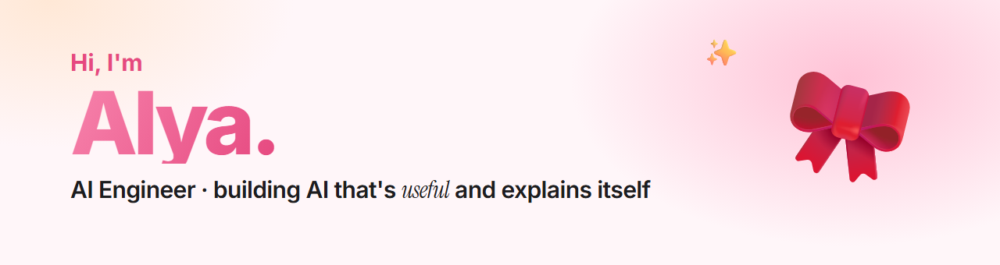
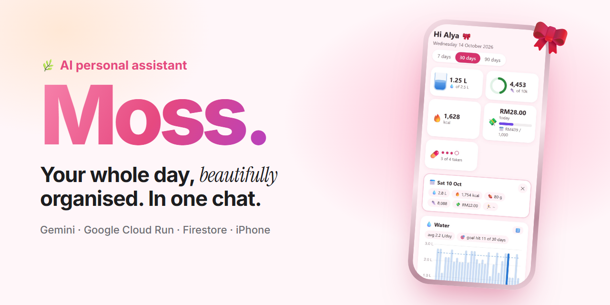
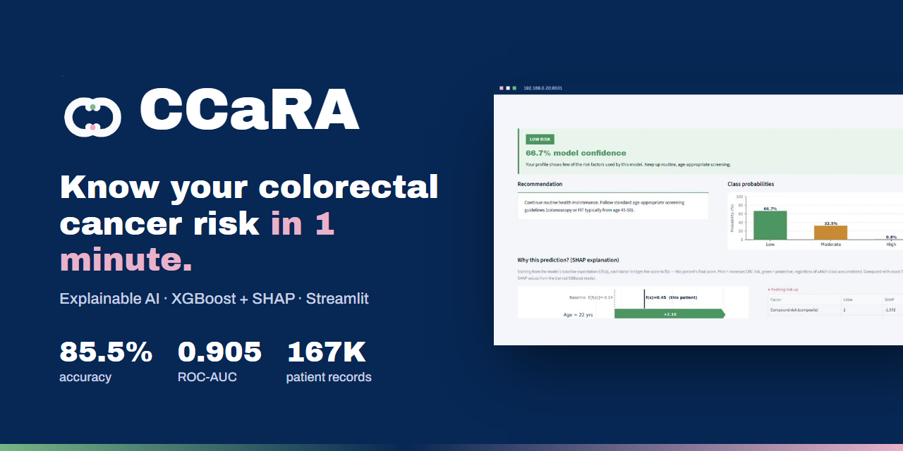

### 🎀 About me

- 👩‍💻 AI engineer based in Malaysia 🇲🇾
- 🌿 I like turning AI into things people actually use, and making it explain *why*
- 🛠️ Currently building **Moss**, my personal AI assistant, one feature at a time
- 🩺 My final year project, **CCaRA**, predicts colorectal cancer risk with explainable machine learning

### ✨ Projects

<table>
  <tr>
    <td width="50%" valign="top">
      
       <b>🌿 Moss</b>: an AI assistant in Telegram that tracks food, money and habits, sends reminders and live storm &amp; haze alerts, and works with Siri and Apple Pay.
       Gemini · Google Cloud Run · Firestore · GitHub Actions
       🔗 <a href="https://moss-alya.web.app">Interactive page</a> · <a href="https://github.com/m0sshyy/moss-Personal-Chatbot-using-Jev-">Code</a>
    </td>
    <td width="50%" valign="top">
      
       <b>🩺 CCaRA</b>: estimates colorectal cancer risk from 11 simple questions and explains every prediction. 85.5% accuracy, 0.905 ROC-AUC.
       XGBoost · SHAP · scikit-learn · Streamlit
       🔗 <a href="https://github.com/m0sshyy/ccara">Code &amp; demo video</a>
    </td>
  </tr>
</table>

### 🧰 Toolbox

### 📫 Say hi

